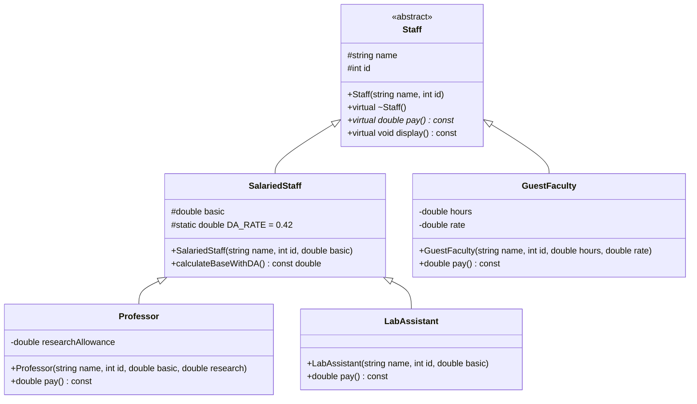
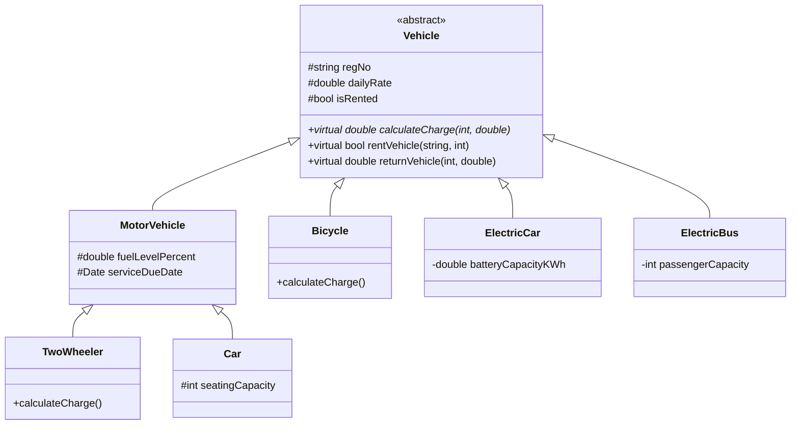

# ASSIGNMENT 4 – CO4: DESIGNING REUSABLE CLASS HIERARCHIES
## Course: Object Oriented Programming with C++ (DSA01)
### Bloom’s Level Assessed: K5 – Evaluate | Nature: Individual Submission

---

# COVER PAGE & SUBMISSION DETAILS
- **Name: sukirtheraj Markas**
- **Course Title:** Object Oriented Programming with C++
- **Course Code:** DSA01
- **Course Outcome:** CO4 – Analyse and implement C++ applications using inheritance, types of inheritance, virtual base classes, abstract classes, pointers and polymorphism to design reusable and extensible programs.
- **Student Name:** [Your Name]
- **Register Number:** [Your Register Number]
- **Compiler:** `g++ (GCC) 13.2.0` / C++17 Standard
- **Exact Compilation Flag:** `g++ -std=c++17 -Wall -Wextra` (and `-fsanitize=address -g`)

---

# TABLE OF CONTENTS
1. [Task 1 – Class Design Review (College Payroll)](#task-1--class-design-review)
2. [Task 2 – From Requirement to Hierarchy (University Management)](#task-2--from-requirement-to-hierarchy)
3. [Task 3 – Constructors in Derived Classes and Member Classes](#task-3--constructors-in-derived-classes-and-member-classes)
4. [Task 4 – Pointers to Derived Classes: Forensics](#task-4--pointers-to-derived-classes-forensics)
5. [Task 5 – Pointers to Objects and the `this` Pointer](#task-5--pointers-to-objects-and-the-this-pointer)
6. [Task 6 – Design Challenge (Vehicle Rental Fleet)](#task-6--design-challenge)
7. [Comprehensive Synthesis & Viva Questions](#comprehensive-synthesis--viva-preparation)

---

# TASK 1 – CLASS DESIGN REVIEW

## 1.1 Diagnosis of Original Design
The legacy college payroll program comprised three isolated classes:
```cpp
class Professor { public: string name; int id; double basic; double da; double research;
double pay() { return basic + basic * 0.42 + research; } };
class LabAssistant{ public: string name; int id; double basic; double da;
double pay() { return basic + basic * 0.42; } };
class GuestFaculty{ public: string nm; int code; double hours; double rate;
double pay() { return hours * rate; } };
```

### Seven Critical Design Flaws (K5 Evaluation):
1. **Redundancy and Code Duplication (Violation of DRY Principle):**  
   Common attributes `name`, `id`, `basic`, and `da` are declared repeatedly. The arithmetic logic `basic + basic * 0.42` is duplicated verbatim in `Professor` and `LabAssistant`.
2. **Complete Absence of Encapsulation:**  
   All data members are declared `public`. External code can arbitrarily mutate salary and identity fields, completely corrupting state invariants.
3. **Inconsistent Domain Nomenclature:**  
   The same conceptual entity is referred to as `name` and `id` in full-time staff, but `nm` and `code` in `GuestFaculty`.
4. **Dead / Orphaned Attribute (`da`):**  
   The member `double da;` is allocated in both classes but never referenced in `pay()`, wasting memory.
5. **Hardcoded Magic Number (`0.42`):**  
   The Dearness Allowance factor is hardcoded as `0.42` instead of an institutional configurable constant.
6. **Violates Open/Closed Principle (OCP):**  
   Introducing a new staff role requires writing an entirely new class from scratch with copy-pasted fields.
7. **Inability to Process in Unified Collection (Lack of Polymorphism):**  
   Without an abstract base class, payroll cannot be processed in a single loop (`std::vector<Staff*>`).

## 1.2 Repaired Hierarchy & UML Diagram
The system is restructured into an abstract base class `Staff`, an intermediate class `SalariedStaff` encapsulating base pay and DA, and derived classes `Professor`, `LabAssistant`, and `GuestFaculty`.

### UML Class Diagram:


## 1.3 Design Defence (< 100 Words)
> The redesigned hierarchy adheres strictly to the Open/Closed Principle. Adding a new staff category requires only creating a new derived class inheriting from `SalariedStaff` or `Staff` and overriding `pay()`. Zero modifications to existing classes or client payroll routines are necessary. Common identity and salary computation logic are reused via inheritance, while client code processes all diverse staff types through a unified collection of base-class pointers (`Staff*`), achieving complete loose coupling and runtime polymorphism.

## Task 1: Alternative Concept & Complexity Analysis
- **Monolithic Class Approach:** A single `Staff` class with an `enum StaffType` and a `switch(type)` in `pay()`.
- **Time Complexity:** Both approaches exhibit $\mathcal{O}(1)$ time per `pay()` call.
- **Space Complexity:**  
  - OOP Hierarchy: $\mathcal{O}(1)$ optimal memory per instance (e.g. `GuestFaculty` allocates only `hours` and `rate` + `vptr`).  
  - Monolithic Class: $\mathcal{O}(1)$ bloated memory; every object allocates space for ALL union fields (`basic`, `research`, `hours`, `rate`), wasting 88+ bytes per instance.
- **Maintenance / Ripple Effect:** Adding a new staff role in the OOP hierarchy changes **1 place** (new class file). In the monolithic class, it forces modifications across **4+ distinct places** (`enum`, member list, constructor, and `switch` statements), violating OCP.

---

# TASK 2 – FROM REQUIREMENT TO HIERARCHY

## 2.1 Relationship Identification & Classification
- `Student is-a Person`: Hierarchical / Single Public Inheritance.
- `Staff is-a Person`: Hierarchical / Single Public Inheritance.
- `TeachingAssistant is-a Student` and `is-a Staff`: Multiple / Hybrid (Diamond) Inheritance.
- `ResearchScholar is-a Student`: Multilevel Public Inheritance.
- `Fellowship in ResearchScholar`: Composition (`has-a` member class).

## 2.2 Resolving the Diamond with Virtual Base Classes
Without virtual inheritance, `TeachingAssistant` contains two independent `Person` sub-objects. This causes:
1. Compiler ambiguity on `ta.name` (`request for member 'name' is ambiguous`).
2. Memory duplication and state inconsistency.
Declaring `struct Student : virtual public Person` and `struct Staff : virtual public Person` forces the compiler to allocate **only one shared `Person` sub-object** inside `TeachingAssistant`, referenced via virtual base pointers (`vbptr`).

## 2.3 Access Table
Visibility of base class (`Person`) members within derived class (`Student`):

| Member Access in Base (`Person`) | Public Inheritance (`public Person`) | Protected Inheritance (`protected Person`) | Private Inheritance (`private Person`) |
| :--- | :--- | :--- | :--- |
| **`public` member** | **`public`** in Student | **`protected`** in Student | **`private`** in Student |
| **`protected` member** | **`protected`** in Student | **`protected`** in Student | **`private`** in Student |
| **`private` member** | **Hidden / Inaccessible directly** | **Hidden / Inaccessible directly** | **Hidden / Inaccessible directly** |

## 2.4 Predict the Output (Task 2)
### Given Program:
```cpp
#include <iostream>
struct Person { Person() { std::cout << "Person "; } };
struct Student : virtual Person { Student() { std::cout << "Student "; } };
struct Staff : virtual Person { Staff() { std::cout << "Staff "; } };
struct TeachingAssistant : Student, Staff {
TeachingAssistant() { std::cout << "TA "; }
};
int main() { TeachingAssistant ta; std::cout << '\n'; }
```
- **Predicted Output:** `Person Student Staff TA `
- **Actual Output:** `Person Student Staff TA `
- **Evaluation:** In virtual inheritance, the shared virtual base `Person` is initialized first and only once by the most-derived class `TeachingAssistant`. Then non-virtual direct bases run in declaration order (`Student`, then `Staff`), followed by the `TeachingAssistant` constructor body.
- **Removing `virtual`:** Output becomes `Person Student Person Staff TA `, and access to `ta.Person::...` becomes ambiguous.

---

# TASK 3 – CONSTRUCTORS IN DERIVED CLASSES AND MEMBER CLASSES

## 3.1 Passing Values to Base Constructors
```cpp
TeachingAssistant(const std::string& n, const std::string& city,
                  const std::string& pr, const std::string& crs,
                  const std::string& d, int h)
    : Person(n, city),            // Most-derived class MUST call virtual base directly!
      Student(n, city, pr, crs),  // Intermediate base
      Staff(n, city, d),          // Intermediate base
      hours(h) {}
```
**Why Most-Derived Class Calls Virtual Base:**  
To prevent intermediate classes (`Student`, `Staff`) from passing conflicting initialization values to the single shared `Person` sub-object, C++ rules state that intermediate constructor calls to virtual bases are bypassed; the most-derived class initializes the virtual base directly.

## 3.2 Member Classes (Composition)
- `Address` is embedded inside `Person`.
- `Course` is embedded inside `Student`.

## 3.3 Tracing the Order of Construction and Destruction
```
1.  [Construct] Address(Salem)          <-- Member of Virtual Base
2.  [Construct] Person(Karthik)          <-- Virtual Base Class
3.  [Construct] Course(AI201)           <-- Member of 1st Direct Base
4.  [Construct] Student(M.Tech)          <-- 1st Direct Base Class
5.  [Construct] Staff(CSE)               <-- 2nd Direct Base Class
6.  [Construct] TeachingAssistant(15 hrs)<-- Most-Derived Class Body
----------------------------------------------------------------------
7.  [Destruct]  ~TeachingAssistant(15 hrs)<-- Most-Derived Destructor Body
8.  [Destruct]  ~Staff(CSE)              <-- 2nd Direct Base Destructor
9.  [Destruct]  ~Student(M.Tech)         <-- 1st Direct Base Destructor
10. [Destruct]  ~Course(AI201)          <-- Member of 1st Direct Base
11. [Destruct]  ~Person(Karthik)         <-- Virtual Base Destructor
12. [Destruct]  ~Address(Salem)          <-- Member of Virtual Base
```

### Universal Order Rule:
1. Virtual base classes constructed first.
2. Direct non-virtual base classes constructed in declaration order.
3. Member objects constructed in class definition declaration order.
4. Derived class constructor body executes.
*Destruction executes in exact reverse order.*

## 3.4 Predict the Output (Engine, Vehicle, Car)
- **Predicted Output:** `Vehicle Engine Car | ~Car ~Engine ~Vehicle `
- **Actual Output:** `Vehicle Engine Car | ~Car ~Engine ~Vehicle `

## 3.5 Complete the Code & `-Wreorder` Warning
Completed constructor for `Student`:
```cpp
Student(const std::string& n, int a, long long r, const std::string& c, int p)
    : Person(n, a), regNo(r), home(c, p) {}
```
Output: `192311001 Kavya (19) Salem-636001`

**Swapped Order Warning:**
Placing `home(c, p)` before `regNo(r)` triggers:
```
warning: 'Address Student::home' will be initialized after [-Wreorder]
warning:   'long long int Student::regNo' [-Wreorder]
```
*Reason:* C++ initializes member objects in the order they are declared in the class definition, NOT the initializer list order.

---

# TASK 4 – POINTERS TO DERIVED CLASSES: FORENSICS

## 4.1 Identification of Three Fatal Defects
1. **Static Early Binding on `rate()`:** Non-virtual `rate()` invokes `Account::rate()` (3.5%) rather than `SeniorAccount::rate()` (4.0%).
2. **Missing Virtual Destructor:** Calling `delete a;` where `a` is `Account*` pointing to `SeniorAccount` invokes undefined behavior, bypassing `~SeniorAccount()` and leaking `history` (800 bytes).
3. **Object Slicing:** Assigning `Account copy = SeniorAccount();` strips away derived attributes and vtable mappings.

## 4.2 Forensic Evidence: AddressSanitizer Report
Compiled with `-fsanitize=address -g`:
```
=================================================================
==ERROR: AddressSanitizer: 800 byte(s) leaked in 1 allocation(s).
Direct leak of 800 byte(s) in 1 object(s) allocated from:
    #0 operator new[](unsigned long)
    #1 SeniorAccount::SeniorAccount() account_buggy.cpp:22
    #2 main account_buggy.cpp:33
=================================================================
```

## 4.3 Predict the Output (Task 4)
```cpp
SeniorAccount s; Account* p = &s; Account copy = s;
std::cout << p->rate() << ' ' << p->vrate() << ' ' << copy.vrate() << '\n';
```
- **Predicted Output:** `3.5 4 3.5`
- **Actual Output:** `3.5 4 3.5`
- **Forensic Breakdown:**
  - `p->rate()` = 3.5 (Static compile-time binding via `Account*`).
  - `p->vrate()` = 4 (Dynamic runtime dispatch via vtable).
  - `copy.vrate()` = 3.5 (Object sliced; `copy` dynamic type is base `Account`).

## 4.4 Rules to Prevent Recurrence
1. *Base Destructor Rule:* Any polymorphic base class must declare a `public virtual destructor`.
2. *Reference/Pointer Rule:* Store polymorphic objects using `std::unique_ptr<Base>` and never by value in standard containers.

---

# TASK 5 – POINTERS TO OBJECTS AND THE `this` POINTER

## 5.1 Four Ways to Reach an Object
1. **Directly by Name:** `Cart c; c.add(...);`
2. **Through Pointer with `->`:** `Cart* p = &c; p->add(...);`
3. **Through Reference:** `Cart& ref = c; ref.add(...);`
4. **Through Dynamic Heap Pointer:** `Cart* d = new Cart(); d->add(...); delete d;`

## 5.2 Array of Pointers Search & Pointer Arithmetic
```cpp
Cart** highestCartPtr = activeCarts;
double maxTotal = (*highestCartPtr)->total();
for (Cart** it = activeCarts + 1; it < activeCarts + NUM_CUSTOMERS; ++it) {
    if ((*it)->total() > maxTotal) {
        maxTotal = (*it)->total();
        highestCartPtr = it;
    }
}
```
Located customer `Ganesh` with highest billing total: **Rs. 1575.00**.

## 5.3 Complete the Code & `Cart` vs `Cart&` Return
Completed methods:
```cpp
Cart& add(const std::string& item, double price) {
    if (n < 10) { items[n] = item; prices[n] = price; ++n; }
    return *this;
}
Cart& setDiscount(double discount) {
    this->discount = discount;
    return *this;
}
```
**If `Cart` returned by value:**  
Temporary copies are generated on the stack at each chain step; subsequent additions mutate discardable temporaries while the original `c` retains only the first item, resulting in severe data corruption.

---

# TASK 6 – DESIGN CHALLENGE: VEHICLE RENTAL FLEET

## Stage 1 – Domain Modeling & Testable Requirements
- **Root Abstract Class:** `Vehicle` (`regNo`, `dailyRate`, `isRented`, pure virtual `calculateCharge()`).
- **Composed Class:** `Date` (`day`, `month`, `year`) for maintenance dates.
- **Specializations:** `Bicycle` (zero-energy), `TwoWheeler` (fuel deficit fee), `Car` (seat surcharge + fuel fee), `ElectricCar` (recharge fee per kWh).

## Stage 2 – UML Architecture Diagram


## Stage 3 & 4 – SIMATS Standard Algorithmic Pseudocode

### Algorithm 1: Vehicle Rental
```
ALGORITHM RentVehicle(regNumber: STRING, customer: STRING, durationDays: INTEGER) -> BOOLEAN
    vPtr <- FindVehicleByRegistration(regNumber)
    IF vPtr = NULL OR vPtr.isRented = TRUE THEN
        RETURN FALSE
    ENDIF
    vPtr.isRented <- TRUE
    vPtr.renterName <- customer
    vPtr.bookedDays <- durationDays
    RETURN TRUE
END ALGORITHM
```

### Algorithm 2: Vehicle Return with Overdue Penalties
```
ALGORITHM ReturnVehicle(regNumber: STRING, actualDays: INTEGER, returnedEnergy: REAL) -> REAL
    vPtr <- FindVehicleByRegistration(regNumber)
    IF vPtr = NULL OR vPtr.isRented = FALSE THEN
        RETURN 0.0
    ENDIF
    baseCharge <- vPtr.calculateCharge(actualDays, returnedEnergy)
    lateFee <- 0.0
    IF actualDays > vPtr.bookedDays THEN
        lateFee <- (actualDays - vPtr.bookedDays) * (vPtr.dailyRate * 1.50)
    ENDIF
    totalBill <- baseCharge + lateFee
    vPtr.isRented <- FALSE
    RETURN totalBill
END ALGORITHM
```

## Stage 5 – Demonstration of Open/Closed Principle
`ElectricBus` was added to the fleet inheriting from `Vehicle`. It adds heavy commercial permit taxes and a 250 kWh battery pack. **Zero existing classes (`Vehicle`, `Car`, `Bicycle`) required modification or recompilation.**

---

# COMPREHENSIVE SYNTHESIS & VIVA PREPARATION

1. **Why is a virtual destructor mandatory in polymorphic base classes?**  
   Deleting a derived object via a base pointer with a non-virtual destructor invokes undefined behavior, resulting in derived destructors being bypassed and heap resources leaking.
2. **What is Object Slicing?**  
   Occurs when a derived class object is assigned to a base class object by value. The derived members and vtable are sliced off, leaving only the base sub-object.
3. **What is the difference between `this` and `*this`?**  
   `this` is a pointer (`ClassName* const`) holding the object's address. `*this` is the dereferenced lvalue reference to the object itself.
4. **Why are virtual bases constructed first?**  
   Because the virtual base sub-object is shared by multiple derived branches, it must exist in memory before any derived branch constructor initializes its own fields.
