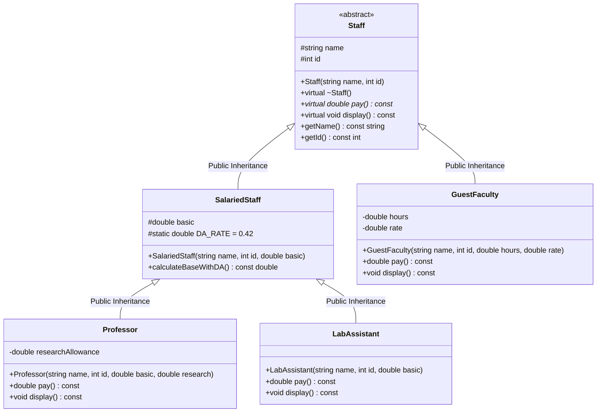

# Task 1: Class Design Review — College Payroll Hierarchy

**Bloom's Level: K5 – Evaluate | Total Marks: 6**

---

## 1.1 Diagnose the Design (2 Marks)

The original code provided by three independent developers suffers from severe structural, architectural, and object-oriented deficiencies:

```cpp
class Professor { public: string name; int id; double basic; double da; double research;
double pay() { return basic + basic * 0.42 + research; } };
class LabAssistant{ public: string name; int id; double basic; double da;
double pay() { return basic + basic * 0.42; } };
class GuestFaculty{ public: string nm; int code; double hours; double rate;
double pay() { return hours * rate; } };
```

### Seven Identified Design Deficiencies:

1. **Repeated Fields and Repeated Business Logic (DRY Violation):**
   - `name`, `id`, `basic`, and `da` are duplicated across `Professor` and `LabAssistant`.
   - The formula `basic + basic * 0.42` is duplicated in both classes. Any policy change to Dearness Allowance (DA) requires updating multiple disparate classes.
2. **Violation of Encapsulation (Public Data Members):**
   - All state members are declared `public`. External code can arbitrarily mutate salary figures, IDs, or names without validation, breaking data invariants.
3. **Inconsistent Naming for Identical Attributes:**
   - Person identification is named `name` and `id` in `Professor` and `LabAssistant`, but `nm` and `code` in `GuestFaculty`. This inconsistency prevents uniform interfaces and causes developer confusion.
4. **Dead / Unused Data Member (`da`):**
   - The field `double da;` is allocated in both `Professor` and `LabAssistant` but is completely unused in `pay()`, wasting memory per instance.
5. **Magic Number (`0.42`):**
   - The literal `0.42` is hardcoded directly into pay equations instead of being defined as a descriptive, centralized constant (`static constexpr double DA_RATE = 0.42;`).
6. **High Maintenance Effort to Add New Staff Categories (OCP Violation):**
   - Introducing another role (e.g., `AdministrativeStaff` or `VisitingFellow`) requires writing a brand new detached class from scratch, leading to further duplication.
7. **Lack of Polymorphism / Inability to Process in a Single Collection:**
   - Because these classes share no common base class or virtual `pay()` method, a client cannot store pointers in a unified array (`std::vector<Staff*>`) to compute institutional payroll in a single loop. Instead, three separate loops and three separate lists would be mandatory.

---

## 1.2 Repair the Design (3 Marks)

### Architecture of the Redesigned Hierarchy:
- **`Staff` (Abstract Base Class):** Encapsulates common attributes (`name`, `id`), provides a `virtual ~Staff() = default;` to avoid undefined behavior during polymorphic deletion, and declares pure virtual function `virtual double pay() const = 0;`.
- **`SalariedStaff` (Intermediate Base Class):** Derives from `Staff`. Encapsulates `basic` and constant `DA_RATE = 0.42`. Provides `calculateBaseWithDA()` to centralize standard DA pay computation.
- **`Professor`:** Derives from `SalariedStaff`. Adds `researchAllowance`. Overrides `pay()`.
- **`LabAssistant`:** Derives from `SalariedStaff`. Directly overrides `pay()` returning base + DA.
- **`GuestFaculty`:** Derives directly from `Staff`. Encapsulates `hours` and `rate`. Overrides `pay() = hours * rate`.

### UML Class Diagram



---

## 1.3 Design Defence (1 Mark)

> **Design Justification (< 100 words):**  
> The redesigned hierarchy adheres strictly to the Open/Closed Principle. Adding a new staff category (e.g., `AdministrativeStaff`) requires only creating a new derived class inheriting from `SalariedStaff` or `Staff` and overriding `pay()`. Zero modifications to existing classes or client payroll routines are necessary. Common identity and salary computation logic are reused via inheritance, while client code processes all diverse staff types through a unified collection of base-class pointers (`Staff*`), achieving complete loose coupling and runtime polymorphism.

---

## Alternative Concept and Complexity Analysis

### Alternative Concept: Monolithic `Staff` Class with Switch Statement
An alternative procedural-in-object approach represents all staff in a single class containing an `enum StaffType { PROFESSOR, LAB_ASSISTANT, GUEST_FACULTY }` and a `switch(type)` inside `pay()`.

```cpp
// Pseudocode of Alternative Concept
class MonolithicStaff {
    StaffType type;
    string name; int id;
    double basic, da, research, hours, rate; // All fields combined
    double pay() {
        switch(type) {
            case PROFESSOR:     return basic + basic * 0.42 + research;
            case LAB_ASSISTANT: return basic + basic * 0.42;
            case GUEST_FACULTY: return hours * rate;
        }
    }
};
```

### Comparative Analysis:

| Metric | Object-Oriented Hierarchy (Our Design) | Monolithic Class with `switch` |
| :--- | :--- | :--- |
| **Time Complexity per `pay()` Call** | **$O(1)$** (1 pointer dereference via vtable) | **$O(1)$** (Branch jump table lookup) |
| **Space Complexity per Object** | **Optimal $O(1)$** (Only fields required by specific type are allocated; e.g., `GuestFaculty` holds 16 bytes for hours/rate + vptr, avoiding `basic` and `research`) | **Wasteful $O(1)$** (Every instance allocates ALL fields; e.g., `GuestFaculty` wastes storage for `basic`, `da`, `research`, yielding 88+ bytes per object) |
| **Places to Change for New Staff Type** | **Only 1 place** (Create the new derived class; 0 edits to existing classes) | **4+ places** (Edit `enum`, add fields to class, edit constructor, edit `switch` in `pay()`, `display()`, etc.) |
| **Open/Closed Principle (OCP)** | Strictly Satisfied | Severely Violated |
