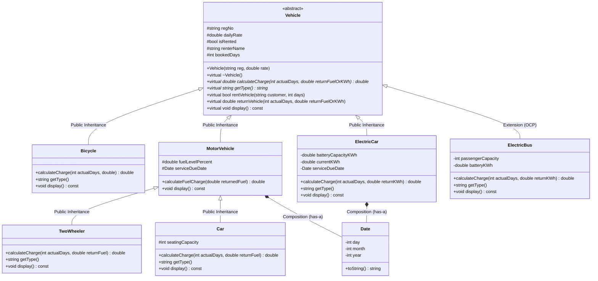

# Task 6: Design Challenge — Vehicle Rental Fleet Management System

**Bloom's Level: K5 – Evaluate | Total Marks: 13**

---

## Stage 1 – Interpret the Problem (2 Marks)

### Domain Entities, State Attributes, and Divergent Behaviors:

1. **`Vehicle` (Root Abstract Entity):**
   - **Attributes:** Registration number (`regNo`), daily rental rate (`dailyRate`), rental status (`isRented`), customer name (`renterName`), booked rental duration (`bookedDays`).
   - **Common Behaviors:** Renting, returning with late fee calculation, inventory listing, status tracking.
2. **`Date` (Member Class / Composition):**
   - **Attributes:** Day, Month, Year. Formats maintenance deadlines.
3. **`MotorVehicle` (Intermediate Specialization):**
   - **Attributes:** Fuel level percentage (`fuelLevelPercent`), next service due date (`serviceDueDate` of type `Date`).
   - **Behavior:** Refill penalty computation for deficit fuel.
4. **`Bicycle`:**
   - Non-motorized, zero fuel/energy surcharges.
5. **`TwoWheeler`:**
   - Motorized, basic fuel refill charge on deficit.
6. **`Car`:**
   - Passenger vehicle with `seatingCapacity`. Imposes seating surcharge for large capacity (>5 seats) + fuel deficit refill.
7. **`ElectricCar`:**
   - Zero-emission electric vehicle. Replaces fuel liters with `batteryCapacityKWh` and charges strictly per consumed kilowatt-hour (kWh).
8. **`ElectricBus` (Extension Entity):**
   - Heavy commercial EV with large battery pack, high passenger volume, and municipal commercial permit taxes.

### Testable Requirements Statements:
- **[R1 - Availability Gate]:** A vehicle can only be rented if `isRented == false`. Double rental requests must be rejected.
- **[R2 - Return Integrity]:** A return transaction is valid only on a currently rented vehicle (`isRented == true`).
- **[R3 - Surcharge Precision]:** Vehicles must compute charges polymorphically based on actual duration and energy consumption.
- **[R4 - Late Return Penalty]:** If `actualDays > bookedDays`, an overdue surcharge of $1.5 \times \text{dailyRate}$ per overdue day is levied.
- **[R5 - Open/Closed Extensibility]:** New vehicle types (e.g., `ElectricBus`) can be added without modifying existing classes.

---

## Stage 2 – Propose the Hierarchy (2 Marks)



---

## Stage 3 – Identify Critical Design Decisions (2 Marks)

1. **Member Allocation & Partitioning:**
   - `regNo`, `dailyRate`, `isRented` are placed in root `Vehicle` to allow uniform lifecycle tracking.
   - `serviceDueDate` is composed via member class `Date` in `MotorVehicle` and `ElectricCar`.
   - `batteryCapacityKWh` is encapsulated exclusively in electric vehicles.
2. **Polymorphic Interface Specification:**
   - `calculateCharge(int, double)` is pure virtual (`= 0`) in `Vehicle` because charge formulas differ radically by vehicle physics (fuel liters vs kWh vs zero-energy).
   - `~Vehicle()` is `virtual` to ensure derived destructors execute cleanly upon deallocation.
3. **Fleet Storage Strategy:**
   - Stored polymorphically as `std::vector<std::unique_ptr<Vehicle>>`.
   - Provides $O(1)$ amortized insertion, automatic deterministic heap memory reclamation via RAII, and total elimination of object slicing.

---

## Stage 4 – Class Declarations & Algorithmic Pseudocode (4 Marks)

*(Pseudocode adheres to SIMATS Engineering – Standard for Algorithmic Pseudocode)*

### Algorithm 1: Vehicle Rental Process
```
ALGORITHM RentVehicle(regNumber: STRING, customer: STRING, durationDays: INTEGER) -> BOOLEAN
    INPUT: regNumber of vehicle, customer name string, duration in days
    OUTPUT: True if rented successfully, False otherwise

    vehiclePtr <- FindVehicleByRegistration(regNumber)
    IF vehiclePtr = NULL THEN
        OUTPUT "Error: Vehicle not found in inventory."
        RETURN FALSE
    ENDIF

    IF vehiclePtr.isRented = TRUE THEN
        OUTPUT "Error: Vehicle already rented to " + vehiclePtr.renterName
        RETURN FALSE
    ENDIF

    vehiclePtr.isRented <- TRUE
    vehiclePtr.renterName <- customer
    vehiclePtr.bookedDays <- durationDays
    OUTPUT "Success: Vehicle rented successfully."
    RETURN TRUE
END ALGORITHM
```

### Algorithm 2: Vehicle Return and Billing Calculation
```
ALGORITHM ReturnVehicle(regNumber: STRING, actualDays: INTEGER, returnedEnergyLevel: REAL) -> REAL
    INPUT: regNumber, actual duration elapsed, returned fuel percentage or remaining kWh
    OUTPUT: Total rental bill amount payable

    vehiclePtr <- FindVehicleByRegistration(regNumber)
    IF vehiclePtr = NULL OR vehiclePtr.isRented = FALSE THEN
        OUTPUT "Error: Vehicle cannot be returned."
        RETURN 0.0
    ENDIF

    // Polymorphic dynamic dispatch
    baseAndEnergyCharge <- vehiclePtr.calculateCharge(actualDays, returnedEnergyLevel)
    lateFee <- 0.0

    IF actualDays > vehiclePtr.bookedDays THEN
        overdueDays <- actualDays - vehiclePtr.bookedDays
        lateFee <- overdueDays * (vehiclePtr.dailyRate * 1.50)
    ENDIF

    totalBill <- baseAndEnergyCharge + lateFee

    // Reset vehicle state
    vehiclePtr.isRented <- FALSE
    vehiclePtr.renterName <- ""
    vehiclePtr.bookedDays <- 0

    RETURN totalBill
END ALGORITHM
```

---

## Stage 5 – Implementation & Extensibility Demonstration (3 Marks)

### Program Execution Highlights (`vehicle_rental_fleet.cpp`):
1. **Diverse Vehicle Instantiation:**
   - Instantiates `Bicycle`, `TwoWheeler`, `Car`, `ElectricCar`.
2. **Late Return Handling:**
   - Car booked for 4 days, returned after 6 days with 30% fuel deficit:
     - Rental base: $2200 \times 6 = 13,200$
     - Fuel refill penalty: $30\% \times 1.20 = 36$
     - Seat surcharge (7 seats): $150 \times 6 = 900$
     - Late penalty (2 days @ 1.5x): $2 \times (2200 \times 1.50) = 6,600$
     - Total bill: **Rs. 20,736.00**.
3. **Seamless Addition of `ElectricBus` (Open/Closed Principle):**
   - `ElectricBus` was added to the fleet inheriting from `Vehicle`.
   - Incorporates high passenger capacity (42 seats) and commercial permit tax (Rs. 500/day).
   - **Zero existing classes (`Vehicle`, `Car`, `Bicycle`) were touched or recompiled!**

---

## Alternative Concept and Complexity Analysis

### Alternative Concept: Monolithic `Vehicle` Class with `typeCode` and `switch`

```cpp
class MonolithicVehicle {
    int typeCode; // 1: Bicycle, 2: TwoWheeler, 3: Car, 4: ElectricCar
    string regNo; double dailyRate;
    double fuelLevel; Date serviceDate;
    int seatingCapacity; double batteryCapacityKWh;
    
    double calculateCharge(int days, double returnLevel) {
        switch(typeCode) {
            case 1: return dailyRate * days;
            case 2: return dailyRate * days + (100 - returnLevel) * 1.20;
            case 3: return dailyRate * days + (100 - returnLevel) * 1.20 + (seatingCapacity > 5 ? 150 * days : 0);
            case 4: return dailyRate * days + (batteryCapacityKWh - returnLevel) * 12.50;
            default: return 0.0;
        }
    }
};
```

### Comparative Analysis:

| Metric | Object-Oriented Polymorphic Design | Monolithic Class with `switch` |
| :--- | :--- | :--- |
| **Time per `charge()` Call** | **$O(1)$** (1 vtable indirection) | **$O(1)$** (Branch table jump) |
| **Space per Object** | **Optimal $O(1)$** (Bicycle occupies ~48 bytes; only stores fields it needs + vptr) | **Bloated $O(1)$** (Every bicycle object wastes memory for `fuelLevel`, `serviceDate`, `seatingCapacity`, `batteryCapacityKWh`, exceeding 120+ bytes) |
| **Extensibility (Adding `ElectricBus`)** | **0 existing files altered.** Simply declare `ElectricBus : public Vehicle`. Strictly follows OCP. | **Violates OCP.** Must modify `typeCode` enum, add bus fields to `MonolithicVehicle`, rewrite constructor, and append cases to all `switch` statements across methods. |
| **Type Safety** | High (Compile-time verified overrides). | Low (Risk of unhandled switch cases, runtime bugs). |
