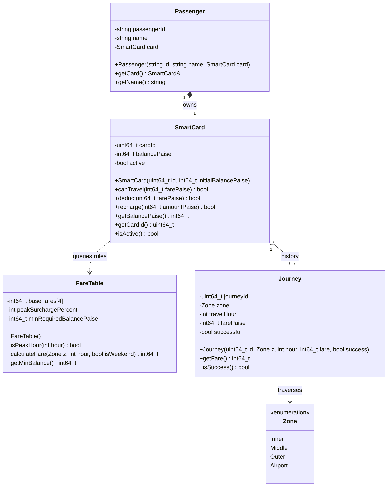

# Task 1: Domain Analysis and Object-Oriented Modeling

## 1. Problem Analysis and Stated Assumptions

### 1.1 Problem Overview
The City Metro Smart-Card System manages automated fare collection for transit commuters across urban geographic zones. The system must:
1. Track commuter identity and prepaid monetary balances on contactless smart cards.
2. Determine transit fares based on origin/destination zonal boundaries and time-of-day peak congestion windows.
3. Validate each transit request against stringent business invariants (such as the minimum security balance requirement).
4. Guarantee transactional integrity: a fare is only deducted if the trip is authorized, preventing negative or sub-minimum balances.

### 1.2 Stated Assumptions
1. **Currency Unit & Precision**: All financial amounts are stored as integer **paise** ($1\text{ Rupee } = 100\text{ paise}$) to prevent IEEE 754 floating-point rounding errors.
2. **Zones**: The standard system contains three concentric or sector zones:
   - `Inner`: Base fare = 1000 paise (₹10.00)
   - `Middle`: Base fare = 2000 paise (₹20.00)
   - `Outer`: Base fare = 3000 paise (₹30.00)
   *(Task 12 introduces a 4th zone: `Airport` at 6000 paise = ₹60.00).*
3. **Peak Surcharge**:
   - Morning peak: 08:00 inclusive to 10:00 exclusive ($[08:00, 10:00)$).
   - Evening peak: 17:00 inclusive to 20:00 exclusive ($[17:00, 20:00)$).
   - Surcharge rate: $+20\%$ added to the base zone fare. Fractional paise are rounded down using integer truncation or standard half-up arithmetic.
4. **Minimum Security Balance**:
   - Every card must retain a minimum balance of **5000 paise (₹50.00)** *after* deducting the trip fare.
   - Condition: $\text{Current Balance} - \text{Fare} \ge 5000\text{ paise}$. If violated, the journey is strictly denied.
5. **Time Representation**: Hour is provided as a 24-hour integer in the range $[0, 23]$.
6. **Journey Lifecycle**: Single-tap fare deduction at journey completion (or exit gate model), assuming entry zone has been validated.

---

## 2. Identified Objects: Data and Behaviors

| Object | Primary Responsibility | Key Attributes (Data) | Key Operations (Behaviors) |
| :--- | :--- | :--- | :--- |
| **`SmartCard`** | Manages commuter prepaid funds and enforces balance invariants. | `cardId: uint64_t`<br>`balancePaise: int64_t`<br>`isActive: bool`<br>`issueTimestamp: uint64_t` | `canTravel(farePaise: int64_t): bool`<br>`deduct(farePaise: int64_t): bool`<br>`recharge(amountPaise: int64_t): bool`<br>`getBalancePaise(): int64_t` |
| **`Passenger`** | Represents the customer profile owning one or more smart cards. | `passengerId: string`<br>`fullName: string`<br>`category: ConcessionType`<br>`card: SmartCard` | `linkCard(card: SmartCard): void`<br>`getConcessionRate(): double` |
| **`Journey`** | Records an instance of transit travel between two points. | `journeyId: uint64_t`<br>`destinationZone: Zone`<br>`entryHour: int`<br>`exitHour: int`<br>`calculatedFarePaise: int64_t`<br>`status: JourneyStatus` | `computeDuration(): int`<br>`isCompleted(): bool` |
| **`Zone`** | Represents geographic metro divisions determining base tariffs. | `zoneId: ZoneEnum`<br>`zoneName: string`<br>`baseFarePaise: int64_t` | `getBaseFare(): int64_t`<br>`getZoneName(): string` |
| **`FareTable`** | Authoritative pricing engine calculating exact payable tariffs. | `baseFares: map/array`<br>`peakMultiplier: int`<br>`minBalancePaise: int64_t` | `calculateFare(zone: Zone, hour: int, isWeekend: bool): int64_t`<br>`isPeakHour(hour: int): bool` |

---

## 3. UML Class Diagram



---

## 4. Procedural vs. Object-Oriented Design

| Aspect | Procedural Paradigm | Object-Oriented Paradigm |
| :--- | :--- | :--- |
| **Core Abstraction** | Procedures, global/local structs, decoupled functions. | Objects encapsulating state and associated behaviors. |
| **State Protection** | Data (`balance`) is openly accessible; caller can accidentally alter balance directly. | State is `private`; invariants are strictly guarded inside member methods. |
| **Extensibility** | Adding new zones or rules requires editing multiple disjoint switches and functions. | Modular classes, inheritance hierarchies, and polymorphic strategy patterns. |
| **Coupling** | High coupling between data structures and algorithm steps. | Low coupling through well-defined public method contracts. |
| **Testing** | Functions are simple to test in isolation, but global state can leak side effects. | High testability: objects can be instantiated in controlled unit tests. |

---

## 5. Four OOP Pillars Applied to Metro Fare Logic

1. **Encapsulation**:
   - `SmartCard::balancePaise` is declared `private`.
   - External code cannot perform `card.balancePaise -= 1000;`. All deductions pass through `deduct(fare)` which validates `balancePaise - fare >= MIN_BALANCE`.
2. **Abstraction**:
   - The caller only needs `card.canTravel(fare)` and `fareEngine.calculateFare(zone, hour)`.
   - Complex details of peak intervals, 20% integer rounding, and mutex thread safety remain hidden behind clean interfaces.
3. **Inheritance**:
   - Base `Pass` or `FareRule` can be extended into `MonthlyPass`, `StudentConcessionPass`, or `TouristPass`.
   - Enables code reuse without duplicating core validation pipelines.
4. **Polymorphism**:
   - Polymorphic method `virtual int64_t computeDiscount(int64_t baseFare) const` allows dynamic resolution of discounts (e.g. Regular Commuter, Senior Citizen, Weekend Discount).

---

## 6. Rules for a Valid Journey

1. **Card Validity**: Card must be non-null, active, and unblocked.
2. **Zone Validity**: Destination zone must belong to recognized enum values.
3. **Temporal Validity**: Travel hour must satisfy $0 \le \text{hour} \le 23$.
4. **Pre-trip Solvency Check**:
   $$\text{balancePaise} - \text{farePaise} \ge \text{MIN\_BALANCE\_PAISE} \quad (5000\text{ paise})$$
5. **Atomic Execution**: Deduct fare if and only if solvency check passes. Under no circumstances may a deduction leave balance below ₹50.

---

## 7. Procedural Alternative and Complexity Analysis

### Procedural Design Outline:
```cpp
struct RawCard {
    uint64_t id;
    int64_t balance;
};

int64_t getBaseFare(int zoneCode);
bool isPeak(int hour);
int64_t calcFare(int zoneCode, int hour);
bool processTrip(RawCard& card, int zoneCode, int hour);
```

### Time and Space Complexity:
- **Time Complexity**: $\mathcal{O}(1)$ (Constant Time). Fare calculation requires a single switch or lookup table, and arithmetic check takes constant CPU cycles.
- **Space Complexity**: $\mathcal{O}(1)$ (Constant Space). Minimal scalar variables allocated on stack memory, zero dynamic heap allocations per journey.
