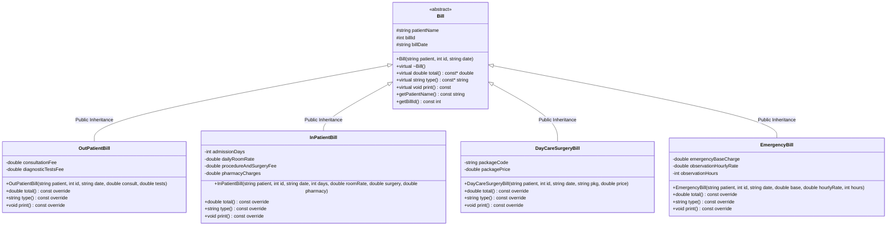

# Task A1: Design the Polymorphic Bill Hierarchy

**Bloom’s Level: K5 – Evaluate | Total Marks: 7**

---

## A1.1 Identify the Common Interface (2 Marks)

In a multi-speciality hospital, diverse medical encounters generate different billing structures. To achieve loose coupling and polymorphism, we extract the core contractual interface that every bill must fulfill, alongside shared patient identity data.

### 1. Operations Required on Every Bill:
- `virtual double total() const = 0;`  
  *(Pure virtual)* Computes the net payable amount based on specialized clinical algorithms.
- `virtual std::string type() const = 0;`  
  *(Pure virtual)* Identifies the bill classification (`"OutPatient"`, `"InPatient"`, `"DayCareSurgery"`, `"Emergency"`).
- `virtual void print() const;`  
  *(Virtual)* Formats and displays an itemized receipt for the patient and audit log.
- `virtual ~Bill() = default;`  
  *(Virtual Destructor)* Guarantees complete and safe resource deallocation during polymorphic deletion.
- `const std::string& getPatientName() const noexcept;`  
  *(Non-virtual getter)* Invariant accessor returning the patient's legal name.
- `int getBillId() const noexcept;`  
  *(Non-virtual getter)* Unique ledger sequence identifier.

### 2. Common Data Members Across All Bills:
- `std::string patientName;` — Legal name of patient.
- `int billId;` — Unique hospital billing transaction number.
- `std::string billDate;` — Date of billing/discharge.

---

## A1.2 Design the Hierarchy (3 Marks)

### Derived Classes Specification:
1. **`OutPatientBill`:**  
   Covers primary care consultations and diagnostic lab/radiology investigations.  
   *Data:* `double consultationFee;`, `double diagnosticTestsFee;`  
   *Formula:* `total() = consultationFee + diagnosticTestsFee`
2. **`InPatientBill`:**  
   Covers hospitalized stays requiring daily room occupancy and complex surgery.  
   *Data:* `int admissionDays;`, `double dailyRoomRate;`, `double procedureAndSurgeryFee;`, `double pharmacyCharges;`  
   *Formula:* `total() = (admissionDays * dailyRoomRate) + procedureAndSurgeryFee + pharmacyCharges`
3. **`DayCareSurgeryBill`:**  
   Fixed standardized package pricing for minor same-day surgical procedures (e.g., Cataract, Endoscopy).  
   *Data:* `std::string packageCode;`, `double packagePrice;`  
   *Formula:* `total() = packagePrice`
4. **`EmergencyBill`:**  
   Critical triage care with a baseline resuscitation charge plus intensive observation hours.  
   *Data:* `double emergencyBaseCharge;`, `double observationHourlyRate;`, `int observationHours;`  
   *Formula:* `total() = emergencyBaseCharge + (observationHourlyRate * observationHours)`

### UML Class Diagram



---

## A1.3 Process All Bills Together (2 Marks)

The algorithm operates over an array of base-class pointers `Bill* bills[]`, dispatching to the concrete implementation at runtime via dynamic polymorphism.

```
ALGORITHM ComputeDailyHospitalTotal(billCollection: ARRAY OF POINTER TO Bill, collectionSize: INTEGER) -> REAL
    grandTotal <- 0.0
    FOR index <- 0 TO collectionSize - 1 STEP 1 DO
        currentBillPtr <- billCollection[index]
        IF currentBillPtr != NULL THEN
            currentBillPtr.print()               // Dynamic Dispatch
            grandTotal <- grandTotal + currentBillPtr.total() // Dynamic Dispatch
        ENDIF
    ENDFOR
    RETURN grandTotal
END ALGORITHM
```
*(Refer to `bill_hierarchy_pseudocode.txt` for the full standard specification).*

---

## Alternative Concept and Complexity Analysis

### Alternative Concept: Single Monolithic `Bill` Struct with `switch`
Instead of an abstract class hierarchy, all bills are stored in a single monolithic structure with an enum tag:

```cpp
enum class BillType { OUT_PATIENT, IN_PATIENT, DAY_CARE, EMERGENCY };

struct MonolithicBill {
    BillType type;
    string patient; int id;
    // Union of all possible fields across all bill types:
    double consultation, tests;
    int days; double roomRate, surgery, pharmacy;
    double packagePrice;
    double emergencyBase, hourlyRate; int hours;

    double total() const {
        switch (type) {
            case BillType::OUT_PATIENT: return consultation + tests;
            case BillType::IN_PATIENT:  return (days * roomRate) + surgery + pharmacy;
            case BillType::DAY_CARE:    return packagePrice;
            case BillType::EMERGENCY:   return emergencyBase + (hourlyRate * hours);
        }
        return 0.0;
    }
};
```

### Comparative Analysis:

| Evaluation Dimension | Polymorphic OOP Hierarchy (Our Design) | Monolithic Struct with `switch` |
| :--- | :--- | :--- |
| **Time to Process $n$ Bills** | **$\mathcal{O}(n)$** (1 vtable indirection per bill) | **$\mathcal{O}(n)$** (1 branch table jump per bill) |
| **Space per Object** | **$\mathcal{O}(1)$ Optimal** (Each object allocates only its own active fields + 8-byte `vptr`; e.g., `OutPatientBill` is 56 bytes) | **$\mathcal{O}(1)$ Bloated** (Every instance allocates ALL fields across all bill kinds, exceeding 128+ bytes per object, wasting >55% memory) |
| **Open/Closed Principle (OCP)** | **Strictly Satisfied.** Adding a new bill type (e.g., `TeleConsultationBill`) requires creating 1 new class. Zero modifications to existing code. | **Severely Violated.** Adding a new type requires modifying `enum BillType`, adding fields to `MonolithicBill`, altering constructors, and editing every `switch` statement across the codebase. |
| **Type Safety & Invariant Guarantees** | Strong (Constructors validate type-specific invariants). | Weak (Unused fields can hold garbage data or be accidentally populated). |
