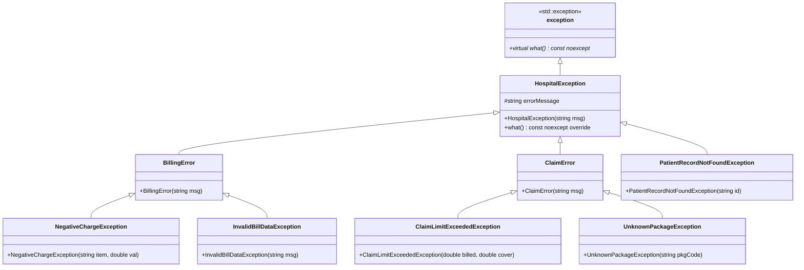

# Task A4: Design the Exception Strategy

**Bloom’s Level: K5 – Evaluate | Total Marks: 4**

---

## A4.1 Error Taxonomy & Exception Hierarchy (2 Marks)

A mission-critical medical billing engine must reject corrupt input immediately and prevent financial leaks without crashing.

### Identified Hospital Error Conditions:
1. **Negative Charges:** Clinical rates, consultation fees, or surgery charges `< 0.0` (Violates financial invariant).
2. **Claim Exceeds Cover:** Patient's billed amount exceeds insurance policy ceiling.
3. **Unknown Package Code:** Invalid or expired surgical package identifier entered for DayCare billing.
4. **Missing Patient Record:** Billing attempt for unregistered or discharged patient ID.
5. **Memory Allocation Failure:** Operating system runs out of heap memory during large billing batch processing (`std::bad_alloc`).

### Exception Class Hierarchy Diagram



---

## A4.2 Exception Specifications & `noexcept` Design (2 Marks)

### Function Classification Matrix:

| Category | Function Signatures | Exception Specification | Justification |
| :--- | :--- | :--- | :--- |
| **Never Throws** | `~Bill()`, `~Payer()`, `~Guard()` | **`noexcept`** (Default in C++11) | **Destructors MUST NEVER throw.** If a destructor throws during stack unwinding while another exception is in flight, the C++ runtime immediately invokes `std::terminate()`, violently killing the program. |
| **Never Throws** | `getPatientName()`, `getBillId()`, `what()` | **`noexcept`** | Invariant state accessors and `what()` methods are guaranteed not to fail; marking them `noexcept` enables compiler optimizations. |
| **May Throw** | `OutPatientBill(...)`, `InPatientBill(...)` | Throws `NegativeChargeException`, `std::bad_alloc` | Constructors validate preconditions (charges $\ge 0$) and throw immediately to abort instantiation of corrupted objects. |
| **May Throw** | `approveClaim(...)`, `amountCovered(...)` | Throws `ClaimError`, `InvalidBillDataException` | Business logic validates claim boundaries; failure indicates contractual breach. |

---

## Alternative Concept and Complexity Analysis

### Alternative Concept: Error Return Codes (`enum Status`)
Instead of C++ exceptions, every function returns an error status code:
```cpp
enum class StatusCode { SUCCESS, ERROR_NEGATIVE_CHARGE, ERROR_EXCEEDS_COVER, ERROR_UNKNOWN_PACKAGE };

StatusCode approve(double billed, double cover, double& outPaid) {
    if (billed < 0 || cover < 0) return StatusCode::ERROR_NEGATIVE_CHARGE;
    if (billed > cover) return StatusCode::ERROR_EXCEEDS_COVER;
    outPaid = billed;
    return StatusCode::SUCCESS;
}
```

### Comparative Analysis:

| Evaluation Dimension | Modern C++ Exceptions (Our Design) | Return Codes (`enum StatusCode`) |
| :--- | :--- | :--- |
| **Happy Path Performance** | **$\mathcal{O}(1)$ Zero-Cost**: In modern 64-bit GCC/Clang (table-driven DWARF unwinding), `try` blocks impose **zero CPU instructions and zero runtime branch overhead** when no exception occurs. | **$\mathcal{O}(1)$ with Branch Penalty**: Every caller must execute conditional branches (`if (status != SUCCESS)`) after every function invocation, consuming instruction cache and branch predictor slots. |
| **Error Path Performance** | Slower ($\mathcal{O}(\text{call stack depth})$): Throwing an exception traverses exception metadata tables. However, errors are anomalous events (<0.1%), so this cost is negligible in practice. | Faster: Error status is returned as an immediate scalar register value. |
| **Robustness & Data Integrity** | **Absolute**: An unhandled exception forces stack unwinding; errors **cannot be silently ignored**. | **Dangerous**: Callers frequently ignore return codes (`approve(...)`), allowing invalid corrupted states to proceed unnoticed into the database. |
| **Clean Code & Separated Concerns** | **High**: Business logic remains pristine and focused; error handling is centralized in dedicated `catch` blocks. | **Low / Cluttered**: Massive boilerplate propagation (`if (rc != OK) return rc;`) cluttering every call level. |
