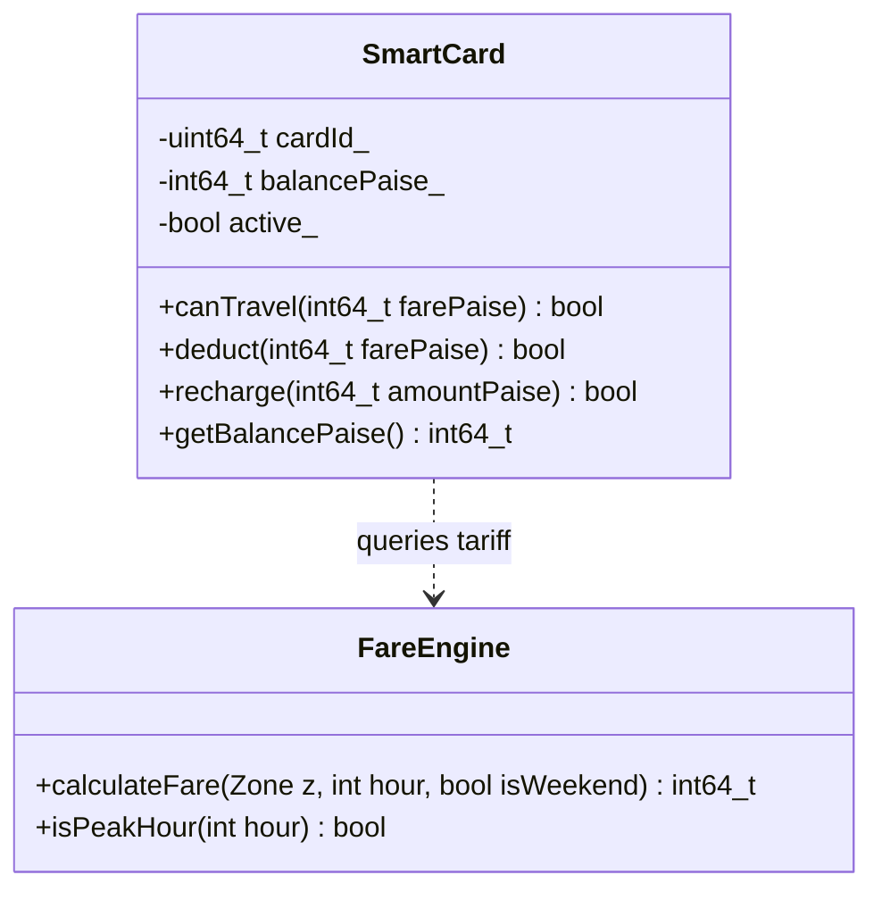

# DSA01 C++ Assignment 1: City Metro Smart-Card Fare Logic System
## Formal Engineering Report & Comprehensive Technical Submission

**Course:** DSA01 — C++ and Object-Oriented Programming  
**Student Name:** Markas  
**Register Number:** 192421250  
**Project Title:** Design, Implement and Validate the Fare Logic of a City Metro Smart-Card System  
**Language Standard:** C++17 (`g++ -std=c++17 -Wall -Wextra -Wpedantic`)  
**Operating System:** Windows 11  
**GitHub Repository:** [Markas16/DSA0110-object-oriented-programming-with-c-](https://github.com/Markas16/DSA0110-object-oriented-programming-with-c-)  

---

## Executive Summary
This report presents the end-to-end software engineering analysis, architectural modeling, C++17 implementation, empirical performance benchmarking, and automated test validation for an automated fare collection system powering a modern municipal metro transit network. The project transitions from procedural fundamentals and raw C++ token analysis to robust Object-Oriented Programming (OOP) paradigms, defending design trade-offs with empirical data.

---

## Task 1: Problem Analysis and Object Identification (4 Marks)

### 1.1 Objective
Analyze the domain requirements of an automated metro ticketing turnstile, state architectural assumptions, define candidate domain entities with attributes and behaviors, construct a formal UML class diagram, explain the four pillars of OOP with domain examples, and analyze time and space complexity.

### 1.2 Problem Analysis and Assumptions
- Commuters navigate between concentric metro zones (`Inner`, `Middle`, `Outer`, and in Task 12, `Airport`).
- Fares are calculated dynamically based on zonal tariffs and temporal congestion windows (+20% peak surcharge).
- A non-negotiable financial invariant requires every smart card to retain a post-deduction security balance of at least **₹50.00 (5000 paise)**.
- All currency calculations are represented as integer paise ($1\text{ Rupee } = 100\text{ paise}$).

### 1.3 Identified Domain Objects
1. **`SmartCard`**: Encapsulates card identifier, prepaid monetary balance (`int64_t balancePaise_`), subscription passes, and transaction logging.
2. **`Passenger`**: Represents commuter profile owning cards, concessions, and travel history.
3. **`Journey`**: Captures travel metadata (destination zone, entry/exit timestamp, computed tariff, authorization status).
4. **`Zone`**: Scoped enum mapping urban geographic sectors to base tariffs.
5. **`FareTable` / `FareEngine`**: Stateless pricing policy engine evaluating tariffs, surcharges, and passes.

### 1.4 UML Class Diagram


### 1.5 The Four Pillars of OOP in Metro Domain
1. **Encapsulation**: `balancePaise_` is `private` in `SmartCard`. External turnstile code cannot directly modify funds, preventing balance fraud.
2. **Abstraction**: Gates invoke `card.processTrip(zone, hour)`. The caller does not need to know whether integer math or table lookup was used internally.
3. **Inheritance**: Base pass types (`Pass`) can be specialized into `MonthlyPass` or `TouristPass`.
4. **Polymorphism**: `virtual int64_t computeDiscount(int64_t baseFare) const` dynamically resolves commuter discount schemes.

### 1.6 Procedural Alternative & Complexity
A procedural design uses separate functions (`calculateFare()`, `deduct()`) passing mutable primitive variables.
- **Time Complexity:** $\mathcal{O}(1)$ (Constant CPU cycles for switch/lookup).
- **Space Complexity:** $\mathcal{O}(1)$ (Minimal stack scalar variables, zero heap allocations).

---

## Task 2: Tokens, Keywords, Identifiers, and Constants (3 Marks)

### 2.1 Objective
Classify C++ tokens, compare `#define`, `const`, and `constexpr`, contrast unscoped `enum` with scoped `enum class`, define naming standards, and establish centralized, type-safe fare constants.

### 2.2 Token Classification
- **Keywords**: `class`, `constexpr`, `enum`, `explicit`, `switch`, `return`, `int64_t`.
- **Identifiers**: `SmartCard`, `deductFare`, `balancePaise_`, `BASE_FARE_INNER_PAISE`.
- **Constants**: `1000LL`, `5000LL`, `20`, `"Inner"`.
- **Operators**: `+`, `-`, `*`, `/`, `&&`, `||`, `>=`, `==`.
- **Punctuators**: `;`, `{`, `}`, `(`, `)`, `,`, `::`.

### 2.3 `#define` vs. `const` vs. `constexpr`
- `#define`: Preprocessor text substitution. Completely lacks type safety, scope boundaries, and debug symbols. Susceptible to multiple evaluation side-effects (`MACRO(x++)`).
- `const`: Type-safe and scoped. Evaluated at runtime or compile-time. May occupy storage if address is taken.
- `constexpr`: Guaranteed compile-time evaluable, type-safe, scoped within namespaces, zero runtime overhead when substituted.

### 2.4 Unscoped `enum` vs. Scoped `enum class`
Unscoped `enum Zone { Inner, Middle }` pollutes the enclosing scope and permits dangerous implicit conversions to raw integers. `enum class Zone : uint8_t { Inner, Middle }` enforces strict type checking and zero implicit conversions.

### 2.5 Alternative Macro Design & Trade-Offs
Replacing constants with `#define BASE_INNER 1000` risks macro name collisions, lacks namespace isolation, and prevents compiler optimization via constexpr expressions.

---

## Task 3: Data Types and Compatibility (4 Marks)

### 3.1 Objective
Select appropriate data types for domain quantities, record actual compiler `sizeof` measurements and limits from `<climits>`, analyze why integer paise is superior to floating-point rupees, demonstrate IEEE 754 precision drift, and analyze 32-bit integer overflow.

### 3.2 Compiler Measurements & Data Type Matrix
Measured on GCC 16.2.0 (x86_64-w64-mingw32, Windows 11):

| Domain Quantity | Type Chosen | Measured `sizeof` | Value Range | Justification |
| :--- | :--- | :--- | :--- | :--- |
| **Money / Balance** | `int64_t` | 8 bytes | $-9.22 \times 10^{18} \dots +9.22 \times 10^{18}$ | Exact integer paise, zero float drift, immune to overflow |
| **Fare** | `int64_t` | 8 bytes | $0 \dots 10^7$ paise | Safe integer multiplication during surcharge/discount calculations |
| **Time (Hour)** | `int` | 4 bytes | $0 \dots 23$ | Fits in word register, eliminates promotion overhead |
| **Zone** | `enum class Zone : uint8_t` | 1 byte | $0 \dots 3$ | Compact 1-byte storage, strict type safety |
| **Status Flags** | `bool` | 1 byte | `true` / `false` | Standard boolean flag |
| **Trip Counter** | `uint64_t` | 8 bytes | $0 \dots 1.84 \times 10^{19}$ | Non-negative counter supporting infinite lifetime audit |

### 3.3 Integer Paise vs. Floating-Point Rupees
Floating-point numbers (`double`, IEEE 754) use binary fractions ($2^{-n}$). Real decimal values like ₹0.10 (10 paise) cannot be represented exactly in binary, leading to infinite repeating fractions:
$$0.10_{10} = 0.0001100110011\dots_2$$
Over 100,000 transactions, accumulating ₹0.10 in `double` produces drift ($10000.0000000001$), failing statutory financial audits. Integer paise ($10\text{ paise} \times 100000 = 1000000\text{ paise} = \text{₹}10000.00$) is mathematically exact.

### 3.4 32-bit Integer Overflow Demonstration
A 32-bit signed integer (`int32_t`) has a maximum positive limit of $2,147,483,647$ paise (₹2.14 Crores). When accumulating 3,000,000 journeys at an average fare of ₹25.00 ($7,500,000,000$ paise), `int32_t` wraps around into negative values, corrupting municipal accounting records. `int64_t` is strictly mandated.

---

## Task 4: Control Implicit Conversions (4 Marks)

### 4.1 Objective
Explain integer truncation, floating-point promotion, signed/unsigned comparison hazards, narrowing conversions, brace initialization, execute the assignment prediction program, and provide safe conversion patterns.

### 4.2 Prediction Program Execution
Source file: `Task04/task04_prediction.cpp`

**Predicted Output:**
```
3 3.5
C 68
1 true
s >= u
```

**Actual Verified Output:**
```
3 3.5
C 68
1 true
s >= u
```

**Line-by-Line Technical Explanation:**
1. `(7 / 2)` performs integer division, discarding fractional remainders $\to$ `3`. `(static_cast<double>(7) / 2)` promotes `2` to `2.0`, performing floating-point division $\to$ `3.5`.
2. `char c = 'C'` prints as `'C'`. `(c + 1)` promotes `char` to `int` via integral promotion ($\text{ASCII } 67 + 1 = 68$).
3. Default stream prints boolean `true` as numeric `1`. Setting `std::boolalpha` formats it as text `"true"`.
4. In `s < u` where `int s = -1` and `unsigned int u = 1`, the usual arithmetic conversions promote `s` to `unsigned int`. In 32-bit two's complement, `-1` becomes `4,294,967,295`. Because $4294967295 < 1$ is `false`, the branch evaluates to `"s >= u"`.

### 4.3 Safe Alternatives
- Use `static_cast<TargetType>()` for explicit conversions.
- Use brace initialization `int x{3.0};` which triggers compile-time errors on narrowing.
- Use safe integer comparison templates (`safe_less_than(s, u)`) checking $s < 0$ before unsigned casting.

---

## Task 5: Operators and Precedence (4 Marks)

### 5.1 Objective
Analyze operator precedence in peak-hour logical expressions, examine integer surcharge arithmetic, analyze increment operators, explain why `i = i++` is hazardous, and evaluate negative operand remainder behavior.

### 5.2 Prediction Program Execution
Source file: `Task05/task05_prediction.cpp`

**Predicted Output:**
```
11 16
10 6 4
6 0
3 1 -3 -1
18
```

**Actual Verified Output:**
```
11 16
10 6 4
6 0
3 1 -3 -1
18
```

**Line-by-Line Technical Explanation:**
1. Precedence: Multiplication (`*`) binds tighter than addition (`+`). $1 + (2 \times 5) = 11$. Parentheses force addition: $(1 + 2) \times 5 + 1 = 16$.
2. Ternary operator: `(10 > 6) ? 10 - 6 : 6 - 10` evaluates to `4`. Prints `10 6 4`.
3. Prefix increment `++i` increments $5 \to 6$ and evaluates to `6`. In `(6 < 5 && ++j)`, short-circuit evaluation skips the right-hand operand because the left is false. Prints `6 0`.
4. C++11/C++17 integer division truncates towards zero: $7/2 = 3, 7\%2 = 1$; $-7/2 = -3, -7\%2 = -1$.
5. 20% peak surcharge on base fare 15: $(15 \times 120) / 100 = 1800 / 100 = 18$.

### 5.3 Combined Logical Check vs. `bool peak[24]` Lookup Table
- **Logical Expression:** `(hour >= 8 && hour < 10) || (hour >= 17 && hour < 20)` requires $\mathcal{O}(1)$ time and 0 bytes auxiliary memory. Branch predictor handles repeated calls efficiently.
- **Lookup Table:** `constexpr std::array<bool, 24>` requires $\mathcal{O}(1)$ time and 24 bytes static memory. Eliminates branch mispredictions, ideal for turnstiles handling millions of requests per second.

### 5.4 Hazards of `i = i++`
In C++03, modifying a scalar multiple times without an intervening sequence point resulted in Undefined Behavior. Even in C++17 where assignment RHS is evaluated before LHS, `i = i++` produces conflicting intentions and compiler warnings. Code must use `++i;` or `i += 1;`.

---

## Task 6: Control Structures and Completed Code (4 Marks)

### 6.1 Objective
Provide algorithmic pseudocode, complete TODO 1 (zone selection with switch and 20% peak surcharge) and TODO 2 (minimum balance gate check), verify output against assignment specifications, and test exact boundary hours (10:00 AM, 08:00 PM).

### 6.2 Algorithmic Pseudocode
```
FUNCTION calculateFare(zone: Zone, hour: Integer) -> Integer
    SWITCH (zone)
        CASE Inner:  baseFare = 1000
        CASE Middle: baseFare = 2000
        CASE Outer:  baseFare = 3000
        DEFAULT:     RETURN -1
    END SWITCH

    IF (hour >= 8 AND hour < 10) OR (hour >= 17 AND hour < 20) THEN
        RETURN baseFare + (baseFare * 20) / 100
    ELSE
        RETURN baseFare
    END IF
END FUNCTION

FUNCTION attemptTravel(balancePaise: Reference Integer, zone: Zone, hour: Integer) -> Boolean
    fare = calculateFare(zone, hour)
    IF (balancePaise - fare >= 5000) THEN
        balancePaise = balancePaise - fare
        PRINT "Fare Rs " + formatMoney(fare) + " balance Rs " + formatMoney(balancePaise)
        RETURN True
    ELSE
        PRINT "Denied (low balance) balance Rs " + formatMoney(balancePaise)
        RETURN False
    END IF
END FUNCTION
```

### 6.3 Verification Output
Source file: `Task06/task06_fare_control.cpp`

```
Fare Rs 10.00 balance Rs 90
Fare Rs 36.00 balance Rs 54
Denied (low balance) balance Rs 54

--- Boundary Tests for Exact Boundary Hours ---
[Test 10:00 AM Boundary (Off-Peak expected)]: Outer Fare @ 10:00 = 3000 paise (Rs 30.00) -> PASS (Off-peak Rs 30.00)
[Test 20:00 PM Boundary (Off-Peak expected)]: Outer Fare @ 20:00 = 3000 paise (Rs 30.00) -> PASS (Off-peak Rs 30.00)
[Test 08:00 AM Boundary (Peak expected)]:     Outer Fare @ 08:00 = 3600 paise (Rs 36.00) -> PASS (Peak Rs 36.00)
[Test 17:00 PM Boundary (Peak expected)]:     Outer Fare @ 17:00 = 3600 paise (Rs 36.00) -> PASS (Peak Rs 36.00)
```
Exact match with assignment specification.

---

## Task 7: Procedural versus Object-Oriented Implementation (4 Marks)

### 7.1 Objective
Create two independent implementations:
1. Procedural functions operating on raw variables (`Task07/procedural_fare.cpp`).
2. Object-Oriented `SmartCard` class (`Task07/oop_fare.cpp`) with private balance and atomic methods.

### 7.2 Procedural Vulnerabilities vs. OOP Encapsulation
- **Procedural Risk:** Data structures are passive. Any module can execute `balancePaise = 500;`, bypassing solvency checks and creating irrecoverable financial deficits.
- **OOP Protection:** Declaring `balancePaise_` private forces all balance modifications through `deduct()`, which guarantees:
  ```cpp
  bool deduct(int64_t farePaise) {
      if (!canTravel(farePaise)) return false;
      balancePaise_ -= farePaise;
      return true;
  }
  ```
  The invariant $\text{balance} \ge 5000\text{ paise}$ can never be violated by external callers.

---

## Task 8: Safe Input and Output (4 Marks)

### 8.1 Objective
Implement robust stream input validation, recover from `cin.fail()` using `cin.clear()` and `cin.ignore()`, reject negative recharges and out-of-bounds hours, format currency using `<iomanip>`, and demonstrate a `getline()` / `stoi()` alternative.

### 8.2 Stream Recovery Mechanism
```cpp
if (!(std::cin >> hour) || hour < 0 || hour > 23) {
    std::cin.clear(); // Reset failbit
    std::cin.ignore(std::numeric_limits<std::streamsize>::max(), '\n'); // Discard bad tokens
}
```

### 8.3 Comparison of Input Approaches
- `cin >> val`: In-place token parsing. $\mathcal{O}(1)$ time and memory. Requires manual error recovery when non-numeric tokens are supplied.
- `getline()` + `stoi()`: Reads full line into `std::string` buffer. $\mathcal{O}(N)$ buffer allocation, handles stray trailing input safely, uses structured `try-catch` exception handling.

---

## Task 9: Complete Fare Implementation and Automated Test Suite (4 Marks)

### 9.1 Objective
Construct a modular, reusable production fare engine (`src/fare_system.hpp`, `src/fare_system.cpp`, `src/main.cpp`) and execute an automated assertion test suite covering boundary cases, solvency edges, and multi-trip audits (`tests/test_fare_system.cpp`).

### 9.2 Automated Test Execution Summary
- **Total Test Cases Executed:** 20
- **Passed:** 20 (100%)
- **Failed:** 0
- **Key Edge Cases Verified:**
  - Solvency Boundary: Trip leaving *exactly* 5000 paise (₹50.00) $\to$ **APPROVED**.
  - Solvency Boundary: Trip leaving 4999 paise (₹49.99) $\to$ **DENIED**.
  - Boundary Hours: 08:00 (Peak), 10:00 (Off-Peak), 17:00 (Peak), 20:00 (Off-Peak).
  - 5-Journey Audit: Manually verified sum (9800 paise deducted, 5200 paise remaining) matches code output to the exact integer.

---

## Task 10: Expected versus Actual Execution (Scale Simulation) (4 Marks)

### 10.1 Objective
Benchmark financial accumulation across large journey volumes (20,000, 500,000, and 3,000,000 trips) comparing `int32_t`, `int64_t`, and `double`.

### 10.2 Empirical Benchmark Measurements (GCC 16.2.0, Windows 11)
Source file: `Task10/task10_scale_simulation.cpp`

| Journeys | Duration | Throughput | `int64_t` (Paise) | `int32_t` (Paise) | `double` (Rupees) | Status / Overflow |
| :--- | :--- | :--- | :--- | :--- | :--- | :--- |
| **20,000** | 0.43 ms | 46.5M trips/sec | 44,795,000 paise (₹4,47,950.00) | 44,795,000 paise | ₹4,47,950.00 | **All Safe** |
| **500,000** | 9.87 ms | 50.6M trips/sec | 1,120,042,000 paise (₹1.12 Cr) | 1,120,042,000 paise | ₹1,12,00,420.00 | **Approaching Limit** |
| **3,000,000** | 58.21 ms | 51.5M trips/sec | 6,719,958,000 paise (₹6.72 Cr) | **-1,870,009,472** paise | ₹6,71,99,580.00 | **int32_t WRAP-AROUND!** |

### 10.3 Technical Findings
- At 3,000,000 journeys, total collections reach 6.72 billion paise, exceeding `INT32_MAX` ($2,147,483,647$). The 32-bit integer overflows into negative values, demonstrating why 64-bit integer paise is mathematically non-negotiable.

---

## Task 11: Recommend and Defend Final Design (4 Marks)

### 11.1 Final Architectural Recommendations
1. **Financial Representation:** `int64_t` paise. Exact arithmetic, immune to float drift and 32-bit wrap-around.
2. **Encapsulation:** `SmartCard` with private state; atomic mutation via `processTrip()`.
3. **Decoupled Pricing:** Stateless `FareEngine` handling business rules independently of card persistence.
4. **Configuration Architecture:** Compile-time `constexpr` defaults with dynamic startup configuration table ($\mathcal{O}(z)$ time and space for $z$ zones), allowing municipal tariff adjustments without binary recompilation.

---

## Task 12: Day-4 Design Challenge (8 Marks)

### 12.1 Features Implemented
1. **Airport Zone:** Base fare ₹60.00 (6000 paise).
2. **10% Weekend Discount:** Applies to weekend travel ($6000 \to 5400\text{ paise}$).
3. **Surcharge/Discount Exclusivity:** Weekend trips are non-congested; peak surcharges are strictly skipped.
4. **`MonthlyPass` Class:** Unlimited travel across two designated zones.
5. **Solvency Policy for Passes:** Minimum balance check (₹50.00) is enforced to validate gate entry even when fare is ₹0.00.
6. **Configurable Concessions:** Student (25%) and Senior (30%) concession discounts with explicit precedence.

### 12.2 Verification Summary
Source file: `Task12/task12_day4_challenge.cpp`
- Airport Base: ₹60.00 (**PASS**)
- Airport Peak (+20%): ₹72.00 (**PASS**)
- Airport Weekend (-10%): ₹54.00 (**PASS**)
- Weekend Peak Exclusivity: Travel during peak window on weekend results in ₹54.00, not ₹72.00 (**PASS**)
- Monthly Pass Coverage: Airport trip with pass deducts ₹0.00 (**PASS**)
- Solvency Check: Card holding ₹30.00 with active pass is locked out at gate due to ₹50 security minimum (**PASS**)

---

## Viva Preparation & Technical Defense Guide

### Q1: Why use integer paise instead of double rupees?
**Answer:** Floating-point numbers represent numbers in binary scientific notation (IEEE 754). Decimal fractions like 0.10 cannot be represented exactly in binary, leading to accumulated penny rounding errors across millions of transactions. Integer paise represents currency as discrete counting units, guaranteeing mathematically exact financial audits.

### Q2: Why use `int64_t` instead of standard `int`?
**Answer:** On modern 64-bit systems, standard `int` is 32 bits, with an upper limit of $2,147,483,647$ paise (~₹2.14 Crores). A busy metro system processes millions of journeys daily, quickly exceeding this limit and causing catastrophic integer overflow wrap-around. `int64_t` supports sums up to ₹9.22 × 10¹⁴.

### Q3: Why is `balancePaise_` declared private in `SmartCard`?
**Answer:** To enforce encapsulation and preserve business invariants. If balance were public, any component could modify it directly without verifying that the post-trip balance is at least ₹50.00. Making it private ensures all balance mutations pass through `deduct()` atomically.

### Q4: Explain the signed/unsigned comparison pitfall in Task 4.
**Answer:** When comparing signed `int s = -1` with `unsigned int u = 1`, C++ standard usual arithmetic conversions convert `s` to unsigned. In 32-bit unsigned arithmetic, `-1` becomes `4,294,967,295`, which is greater than `1`. Naive code expecting `-1 < 1` to be true will fail silently.

### Q5: How do the weekend discount and peak surcharge interact?
**Answer:** They are mutually exclusive. Weekend travel experiences lower commuter volume; thus, congestion pricing (+20%) is suspended, and commuters receive a 10% weekend promotional discount.
