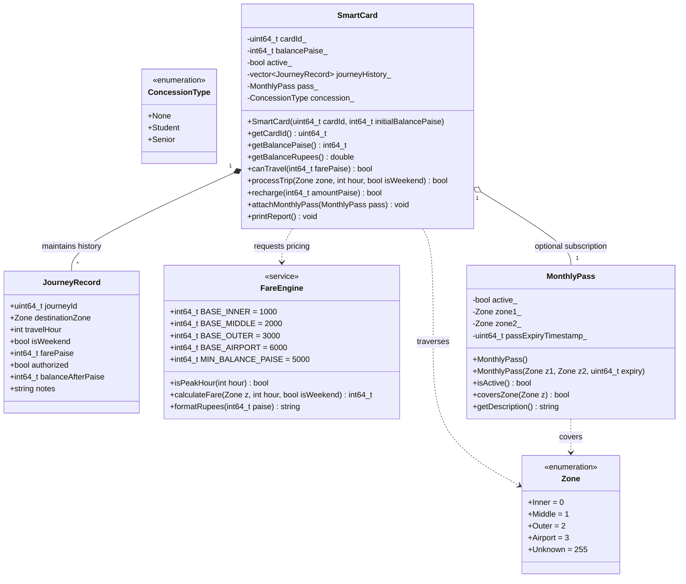
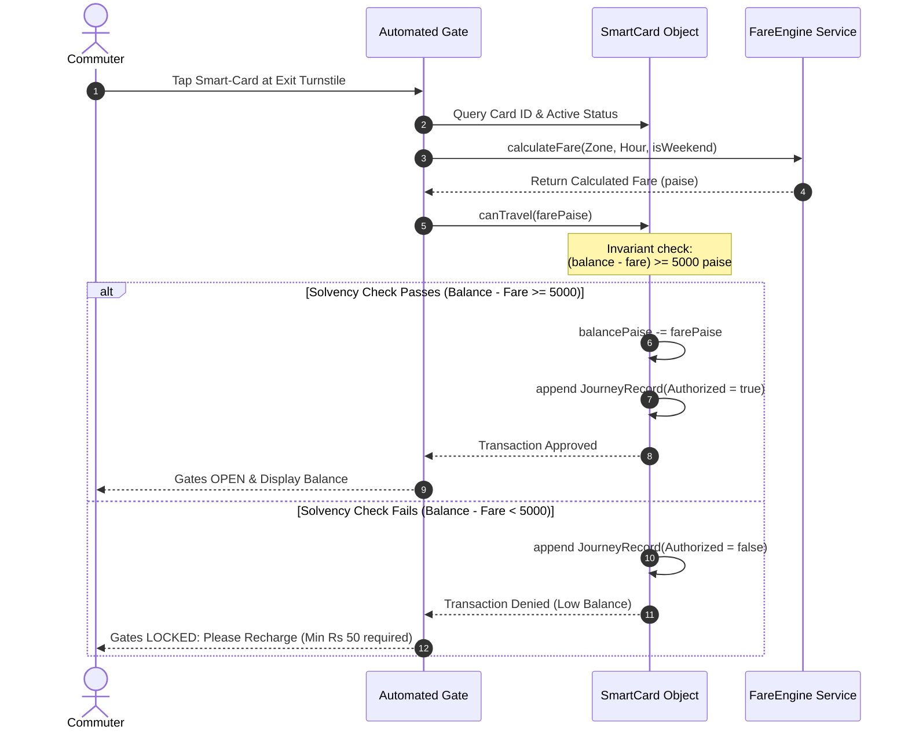
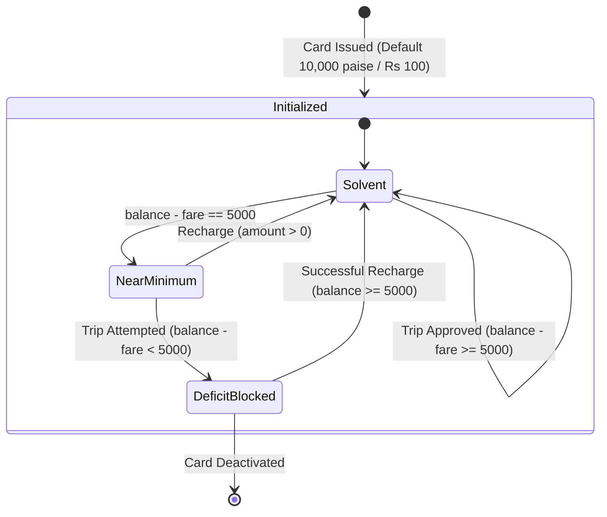

# UML Architecture & Behavioral Diagrams

**System:** City Metro Smart-Card Fare Logic System  
**Student:** Markas (Register No: 192421250)  

---

## 1. Class Diagram (Structural Model)

---

## 2. Sequence Diagram: Tap-and-Go Fare Processing

---

## 3. State Machine Diagram: Smart-Card Balance Lifecycle

